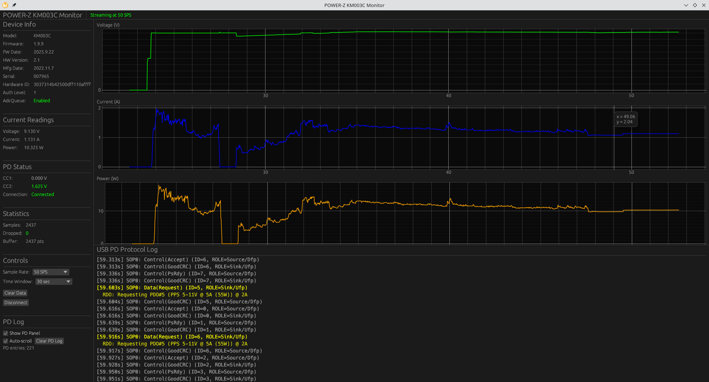
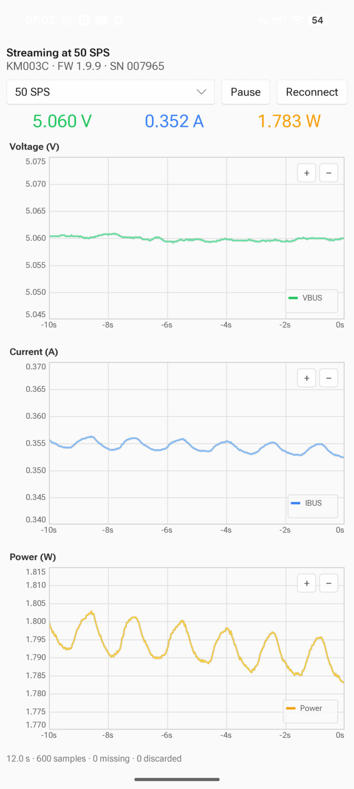
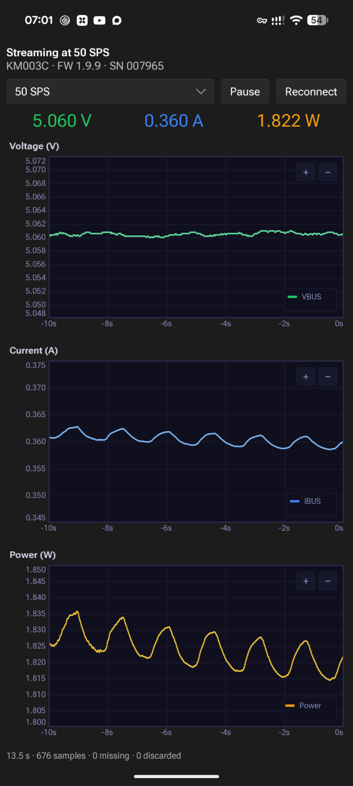
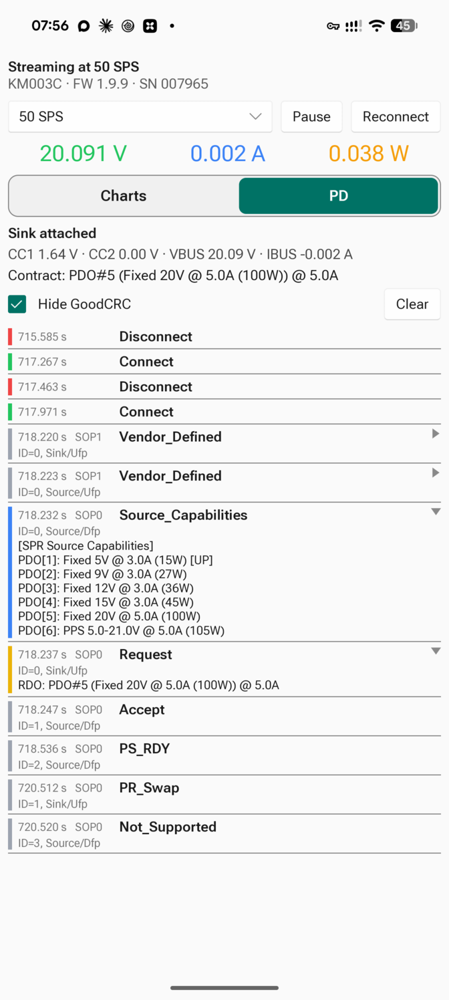

<p align="center"></p>

<h1 align="center">km003c-rs</h1>

<p align="center">Typed Rust library, command-line interface, GUI monitors, and Python bindings for the ChargerLAB POWER-Z KM003C USB-C power analyzer.</p>

<p align="center">
  <a href="https://crates.io/crates/km003c-lib"></a>
  <a href="https://docs.rs/km003c-lib"></a>
  
  <a href="https://github.com/okhsunrog/km003c-rs/actions/workflows/ci.yml"></a>
</p>

## Overview

`km003c-rs` provides asynchronous device communication, recorded-packet
parsing, real-time power analysis, and USB Power Delivery capture. Physical
values in the Rust API are type-safe [`uom`](https://docs.rs/uom) quantities.



## Features

### Device Communication
- Dual interface support: Vendor (bulk, ~0.6ms latency) or HID (interrupt)
- Cross-platform support using `nusb`
- Asynchronous communication with Tokio
- Automatic device discovery, initialization, and authentication

### ADC Data Acquisition
- Real-time voltage, current, and power measurements
- Two modes:
  - **Simple ADC**: Single-shot readings with temperature and statistics
  - **AdcQueue streaming**: High-speed continuous streaming (2, 10, 50, 1000 SPS)
- USB data line voltage measurements (D+, D-)
- USB-C CC line voltage measurements (CC1, CC2)

### USB Power Delivery Support
- Capture and parse USB PD messages
- Connection/disconnection event detection
- Full PD message parsing using the `usbpd` crate
- Support for SPR and EPR source capabilities
- Chunked message reassembly for EPR
- Typed firmware Type-C and protocol-engine state traces

### Device Information
- Model, firmware version, hardware version
- Serial number and UUID
- Hardware ID and authentication level

## Components

### `km003c-lib`
Core library providing:
- Device communication and automatic initialization
- Streaming authentication (required for AdcQueue)
- Firmware-selected calibration authentication for level-2 operations
- ADC and AdcQueue data parsing
- CRC-validated read-only device settings
- Offline recording catalog and encrypted log downloads
- USB PD event parsing
- Optional stateful USB PD semantic decoding through the `usbpd` feature,
  with the PD message log and the negotiated power contract
- Typed firmware PD state-trace parsing and display entries
- The long-running device session, measurement stream and offline recording
  view the GUIs are built on
- Optional live recording, offline export and polars `DataFrame` conversion
  through the `polars` feature, with recovery of recordings a crash
  interrupted
- Optional preferences shared by the GUIs through the `preferences` feature
- Complete firmware maintenance with frontend-supplied backup storage and typed
  progress; optional `firmware-catalog` for official releases with archive fallback

### `km003c-cli`
One `km003c` executable with clap subcommands:
- `info` - Device, firmware, and authentication information
- `adc read` / `adc stream` - Single-shot measurements or AdcQueue streaming
- `logs list` / `logs download` - Offline recording catalog and CSV/Parquet/JSON export
- `pd capture` / `pd trace` - USB PD messages or internal firmware events
- `debug memory read` / `debug memory scan` - Memory inspection for protocol research
- `firmware list` / `firmware download` - Mirrored releases and release notes
- `firmware inspect` / `firmware check` / `firmware update` - Package validation,
  device checks and experimental firmware installation, including downgrades

Connection flags (`--interface`, `--serial`, `--no-reset`, `--reset`) and
`--verbose` are shared and can appear before or after subcommands. HID is
supported only for `adc read`; other commands require the vendor interface.
Diagnostic logs go to stderr, keeping `logs list --json` machine-readable.
Firmware commands never reset USB implicitly and reject `--reset`.

### `km003c-egui`

Runs on desktop and in Chromium browsers via WebUSB and WebGPU. See [browser setup,
constraints and hardware validation](km003c-egui/WEB.md).

The [browser monitor](https://okhsunrog.github.io/km003c-rs/) is published from
`main` to GitHub Pages. USB communication, plotting and export run locally in
the browser; no USB server or desktop application is needed. Use desktop Chrome
or Edge and follow the [Linux setup](km003c-egui/WEB.md#linux-setup) if applicable.

GUI application featuring:
- Three independently configurable GPU plots for live or device-stored measurements
- Shared wgpu core with Slint: line segments and compute min/max envelopes,
  with incremental sample uploads and real timestamps
- AdcQueue streaming with configurable sample rates
- Large live V/A/W readings and Charts / USB PD / Recordings / Firmware tabs
- Shared X-only zoom/pan, timestamp cursor and stable stepped, fitted or manual Y scales
- Adjustable time window (2s to 5min or all data), with a separate view pause
- Live recording and plot-buffer export to Parquet or CSV
- Device-stored offline recording catalog, download, plotting, and Parquet/CSV export
- Host-integrated charge and energy with explicit missing-sample quality data
- Combined wire-message and firmware-state USB PD timeline with source filters
- Device settings with auth status and browser permission reuse after reload
- Separate acquisition Start/Stop, file recording, view pause and USB Disconnect
- Firmware upgrades, downgrades and reinstalls from the official server, archive or a local
  `.mencrypt` package, with confirmation, verified backup and readback progress

### `km003c-slint` (experimental)
A second GUI built with [Slint](https://slint.dev) that also runs on Android
phones, with the meter plugged into the phone:
- Live voltage, current and power charts rendered on the GPU, at up to 1000 SPS
- Pinch or scroll to zoom, double tap to pause, drag to pan through history
- PD tab with sink detection, CC readings, the negotiated contract, the PD
  message log and the firmware trace
- Files tab: live recording to Parquet or CSV, and export of the recordings
  stored on the meter
- Automatic reconnection when the device is replugged
- Shares everything but the widgets with `km003c-egui` through `km003c-lib`:
  the device session, measurements, PD log and contract, recording, export
  and preferences. On the desktop both apps read the same preferences file.

It cannot plot the recordings stored on the meter yet, only export them. See
[`km003c-slint/README.md`](km003c-slint/README.md) for the Android build.

<p align="center">
  
  
  
</p>

### Python Bindings

Python bindings expose the parser using numeric properties with explicit unit
suffixes such as `vbus_v`, `ibus_a`, and `power_w`.

## Quick Start

### Prerequisites
- Rust 1.97+
- USB access permissions (udev rules on Linux)
- POWER-Z KM003C device

### Installation

```bash
git clone https://github.com/okhsunrog/km003c-rs.git
cd km003c-rs
cargo build --release
```

### Linux USB Permissions

Create udev rules for non-root access:

```bash
sudo cp 71-powerz-km003c.rules /etc/udev/rules.d/
sudo udevadm control --reload-rules
sudo udevadm trigger
```

The rules use the `uaccess` tag for secure, dynamic access to logged-in users.

The browser monitor also needs interface 0 to be free of the `powerz` kernel
driver. An optional rule automatically releases it; see
[Linux WebUSB setup](km003c-egui/WEB.md#linux-setup), including its effect on hwmon
and NixOS installation.

### Usage Examples

#### ADC Reading

```bash
cargo run --bin km003c -- info
cargo run --bin km003c -- adc read
```

#### AdcQueue Streaming

```bash
cargo run --bin km003c -- adc stream --rate 50 --duration 10

# Print every sample; current is displayed in amperes.
cargo run --bin km003c -- adc stream --rate 1000 --duration 10 --every 1
```

#### USB PD Capture

```bash
cargo run --bin km003c -- pd capture
cargo run --bin km003c -- pd trace --polls 10
```

#### Offline Recordings

```bash
cargo run --bin km003c -- logs list
cargo run --bin km003c -- logs download --latest --output recording.csv
cargo run --bin km003c -- logs download --index 0 --output recording.parquet
cargo run --bin km003c -- logs download --latest --format json
```

Choose exactly one of `--index` and `--latest`. The meter does not expose
recording timestamps: `--latest` selects the highest numbered `A<number>.d`
filename, and asks for `--index` if it encounters an unfamiliar naming scheme.
The output format follows the `.csv`, `.parquet`, or `.json` extension;
without an output path or explicit `--format`, it defaults to CSV.
CSV and Parquet use the same 23-column recording schema as the GUIs. JSON
contains the recording metadata and samples in the device's raw units.

#### Command-line Installation and Help

```bash
cargo install --path km003c-cli --locked
km003c --help
km003c logs download --help
km003c --no-reset logs download --latest --output recording.csv
km003c debug memory read 0x420 --size 64
```

`km003c` replaces the former `adc_simple`, `adc_queue_simple`, `test_usbpd`,
`offline-log`, `pd_trace`, and `memory_scan` executables. Update scripts to use
the corresponding subcommands above. The library's `settings` and
`calibration_auth` examples remain available through `cargo run --example`.

#### Firmware

```bash
km003c firmware list
# From DFU: download and install the latest release, without a local package.
km003c firmware install --yes
# Or select a version or build ID:
km003c firmware install 2.0.7 --yes
km003c firmware download 2.0.7 -o KM003C_V2.0.7.mencrypt
km003c firmware inspect KM003C_V2.0.7.mencrypt
km003c --serial 007965 firmware check KM003C_V2.0.7.mencrypt
# Writes flash; requires an explicit backup path when the application is running:
km003c --serial 007965 firmware update KM003C_V2.0.7.mencrypt --backup current-firmware.bin --yes
```

`list`, `download` and `inspect` do not access USB. The library tries the official
catalog and objects first, then the public
[km003c-resources archive](https://okhsunrog.github.io/km003c-resources/) if HTTP,
catalog parsing or package validation fails. Fallback requires the same version,
date, size and firmware CRC. Archive-selected packages also retain whole-file
SHA-256 verification. The CLI reports the source and fallback reason.
Bundled credentials remain encrypted in the library; no Windows EXE is required.
Existing output files are never overwritten. If a version has multiple builds,
pass the build ID printed by `firmware list` in place of the version argument.
`install` downloads the package in memory and uses the same checks and update
flow as `update`. It selects the release marked latest by the official catalog;
when using the archive, it selects the highest numeric version and newest build
date. Ambiguous latest builds must be selected by ID. As with `update`, include
`--backup PATH` if installing from the stock application rather than DFU.

Official Windows applications, manuals and source archives are kept as
[km003c-resources Release assets](https://github.com/okhsunrog/km003c-resources/releases),
including complete historical `orig_app` snapshots.

`check` reads device identity without rebooting or writing flash. `update`
backs up the current application using two matching reads and verifies its
vectors, identity and CRC, then switches the same
physical USB port into DFU, writes the package, then reboots and checks the
complete application by reading it back. If already in DFU, application backup
is unavailable and `--backup` is not required. A failed transfer leaves DFU
available for a fresh update attempt; data blocks are never retried automatically.

Older and same-version packages use the same update command. The inspected
bootloader has no version-order check, so the client does not prohibit a
downgrade. A release still needs to support the meter's hardware revision.
The backup is the installed application, including its committed metadata;
it is not a `.mencrypt` package or a complete device/calibration backup.

Firmware installation is experimental. On hardware 2.1, the complete cycle
`1.9.9 (2025.9.22) -> 2.0.7 -> original 1.9.9` passed full readback checks;
the final application matched its original backup and the acquired bootloader
region was unchanged. Interrupted-update recovery remains untested. See
[firmware protocol and hardware validation notes](FIRMWARE.md).

#### GUI Application

On NixOS, enter the development shell first. It provides the Wayland, X11 and
Vulkan libraries needed by the desktop GUI, including runtime library paths:

```bash
nix develop
cargo run --release --bin km003c-egui
```

The Rust version comes from `rust-toolchain.toml` through rustup.
The shell also selects a trusted CA bundle for OpenSSL/Python, preserving an
existing `SSL_CERT_FILE` or Nix CA configuration. TLS verification stays enabled.

Browser: open the [hosted monitor](https://okhsunrog.github.io/km003c-rs/) and
click **Start**, then select the KM003C and confirm the browser dialog. To run
locally, install Trunk 0.21.14 and run `trunk serve --release` from the repository
root. See [browser instructions](km003c-egui/WEB.md).

```bash
cargo run --bin km003c-egui

# The experimental Slint GUI is a separate workspace.
cd km003c-slint && cargo run --release
```

The GUI records the complete AdcQueue sample set, independently of which three
measurements are currently plotted. Parquet is the default format; CSV is
available for compatibility. Each row contains device-relative time and
sequence information, VBUS/current/power, CC1/CC2/D+/D- voltages, and cumulative
charge and energy. Integer electrical columns use units in their names
(`*_uv`, `*_ua`, and `*_uw`). Signed net accumulation is stored in
`charge_uah` and `energy_uwh`; positive transferred totals are stored in
`charge_throughput_uah` and `energy_throughput_uwh`.

Charge and energy use trapezoidal integration over the KM003C sequence clock.
If samples are missing, the interval is retained as a linear estimate rather
than invalidating the rest of the recording. The affected row and cumulative
quality are exposed through `missing_samples`, `gap_duration_us`,
`interpolated`, `cumulative_missing_samples`, and
`cumulative_interpolated_duration_us`. Rejected sequence samples are excluded
from plots and integration and counted by
`discarded_sequence_samples` and `cumulative_discarded_sequence_samples`. The
GUI reports completeness as the fraction of elapsed time covered by received
intervals rather than estimated gap intervals.

The **Offline Recordings** section loads the catalog stored by the KM003C,
downloads a selected entry, and switches the same three plots between live and
offline data. Offline exports use the same 23-column Parquet/CSV schema as live
captures. Fields that the device does not store in offline samples—sequence,
marker, sample rate, gap quality, CC1/CC2, and D+/D-—are null rather than
fabricated as zero. Signed charge and energy preserve the device accumulators;
positive throughput is derived from the absolute changes between successive
device accumulator values.

On desktop, a live recording is first appended to a journal, flushed after
every batch, and becomes the Parquet or CSV file when the recording stops. If
the app crashes or is killed mid-recording, the next start converts the journal it
left, so the samples up to the crash are kept. Both GUIs remember the sample
rate, time window, plotted metrics, recording format and PD log filters. On
the desktop they share `~/.config/km003c/preferences.json` and the journal
directory `~/.local/share/km003c/journal` (the platform's equivalents on macOS
and Windows); the Slint app saves recordings to `~/Documents/KM003C`, and on
Android to the app's external files directory.

In the browser, recordings stay in memory until stopped and downloaded, and
preferences use localStorage. Closing the tab loses an unfinished recording;
see [browser limits](km003c-egui/WEB.md#platform-constraints).

## Library Usage

```rust
use km003c_lib::uom::si::electric_current::ampere;
use km003c_lib::uom::si::electric_potential::volt;
use km003c_lib::{DeviceConfig, GraphSampleRate, KM003C};

#[tokio::main]
async fn main() -> Result<(), Box<dyn std::error::Error>> {
    // Connect with vendor interface (Full mode - includes init and auth)
    let mut device = KM003C::new(DeviceConfig::vendor()).await?;

    // Access device info (always available in Full mode)
    let state = device.state().unwrap();
    println!("{}", state);  // Pretty-printed device info
    println!("AdcQueue enabled: {}", state.adcqueue_enabled);

    // Simple ADC reading
    let adc = device.request_adc_data().await?;
    println!("Voltage: {:.3} V", adc.vbus.get::<volt>());
    println!("Current: {:.3} A", adc.ibus.get::<ampere>());

    // AdcQueue streaming (if authenticated)
    if device.adcqueue_enabled() {
        device.start_graph_mode(GraphSampleRate::Sps50).await?;
        // ... poll for samples ...
        device.stop_graph_mode().await?;
    }

    Ok(())
}
```

### Memory reads

Use the correlated high-level operation for a connected device. It validates
the transaction, confirmation address and size, receives all encrypted USB
transfers, and removes AES block padding:

```rust
let hardware_id = device.read_memory_block(0x4001_0450, 12).await?;
assert_eq!(hardware_id.len(), 12);
```

For offline protocol research on previously captured ciphertext, use the pure
decrypt helper instead of a device receive method:

```rust
let plaintext_blocks = km003c_lib::auth::decrypt_memory_read_response(&ciphertext)
    .ok_or("ciphertext must contain complete AES blocks")?;
```

The offline helper returns complete decrypted AES blocks because a capture does
not itself carry the originally requested byte count.

Stored recordings have a higher-level API. Metadata requests return every
catalog entry; each entry carries the memory offset needed to download that
specific log:

```rust,no_run
let catalog = device.request_log_metadata().await?;
if let Some(metadata) = catalog.into_iter().next() {
    let log = device.download_offline_log(metadata).await?;
    println!("downloaded {} samples", log.samples.len());
}
```

### Python bindings

Install the published wheels:

```bash
pip install km003c
```

Wheels are built against the stable ABI, so one wheel per platform covers
CPython 3.8 and newer.

To build and test the extension from a checkout instead:

```bash
uv sync --locked
uv run maturin develop
uv run pytest -q test_bindings.py
```

Context-free AdcQueue parsing preserves raw auxiliary-line counts because their
scale depends on the configured graph rate. Decode them explicitly when the
rate used by `StartGraph` is known:

```python
packet = km003c.parse_packet(captured_bytes)
raw_queue = packet["DataResponse"]["payloads"][0]
queue = raw_queue.decode(km003c.RATE_50_SPS)

# Or parse directly with the known rate.
packet = km003c.parse_packet_with_graph_rate(captured_bytes, km003c.RATE_50_SPS)
```

### Device Configuration

```rust
// Vendor interface (Full mode) - recommended, fastest
let config = DeviceConfig::vendor();

// HID interface (Basic mode) - most compatible, ADC/PD polling only
let config = DeviceConfig::hid();

// Skip USB reset (default on macOS for compatibility)
let config = DeviceConfig::vendor().skip_reset();
```

## Protocol Research

This implementation is based on reverse engineering documented at:
**[km003c-protocol-research](https://github.com/okhsunrog/km003c-protocol-research)**

The research repository contains:
- A capture-backed protocol reference and an explicit list of remaining gaps
- USB transport documentation
- PCAPNG captures and analysis tools
- Firmware analysis notes

## Development Status

### Working Features
- Device discovery and dual-interface communication
- Automatic initialization and streaming authentication
- Simple ADC measurements
- AdcQueue high-speed streaming (2-1000 SPS)
- USB PD message capture and parsing
- Memory read for device info/calibration
- Real-time GUI with plotting, on desktop and (experimentally) Android

### Validation

| Target | Coverage |
|---|---|
| Linux | Tests, lint, docs, package verification, and real KM003C hardware |
| macOS | Workspace compile check; USB reset is skipped by default |
| Windows | Workspace compile check |
| Python 3.13 | Extension build and binding tests |
| Android | `km003c-slint` on a Pixel 8 Pro with a real KM003C; not built in CI |

Protocol tests use recorded device traffic and do not require USB hardware.
Live testing was performed on firmware 1.9.9 with a Pixel 8 Pro PPS charging
through the meter. AdcQueue sequence timing was checked at 2, 10, 50, and
1000 SPS; auxiliary CC/D-line scaling was compared with simultaneous ADC
measurements.

## Development

The Python development tools require Python 3.10 or newer. The package itself
continues to support Python 3.8 or newer.

Common tasks are available through [`just`](https://just.systems):

```bash
just fmt
just test
just lint
just ci
```

Hardware commands are deliberately separate from the offline CI gate; use
`just hardware-stream 50 10` only with a KM003C connected.

## Requirements

- **Rust**: 1.97 or newer
- **Platforms**: Linux, Windows, macOS; Android for the experimental `km003c-slint`
- **Hardware**: POWER-Z KM003C

## Contributing

Contributions welcome! See the research repository for protocol details.

## License

Licensed under either of [Apache License, Version 2.0](LICENSE-APACHE) or
[MIT license](LICENSE-MIT) at your option.

## Related Projects

- **[km003c-resources](https://github.com/okhsunrog/km003c-resources)** - Archived firmware, official applications and manuals
- **[km003c-protocol-research](https://github.com/okhsunrog/km003c-protocol-research)** - Protocol reverse engineering
- **[usbpd](https://crates.io/crates/usbpd)** - Rust USB PD protocol library
