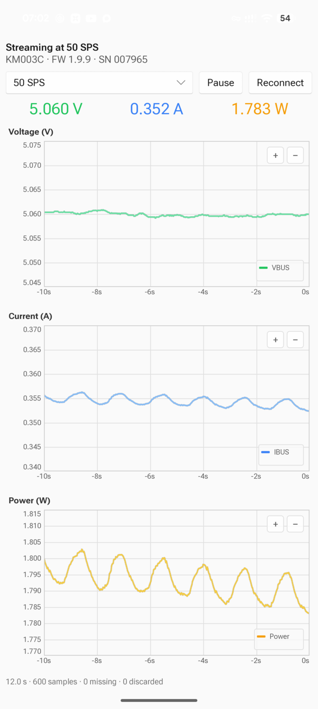
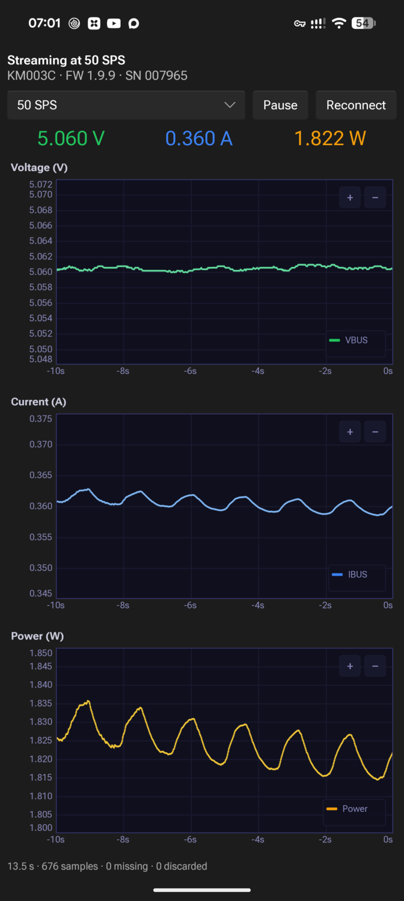
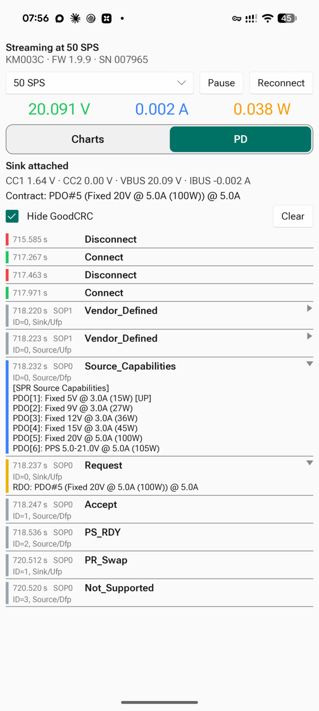

# km003c-slint

Experimental [Slint](https://slint.dev) monitor for the ChargerLAB POWER-Z
KM003C. It runs on desktop and on Android phones with USB host support, with
the meter plugged into the phone.

<p align="center">
  
  
  
</p>

It plots voltage, current and power from the AdcQueue stream at 2, 10, 50 or
1000 SPS. Current and power preserve their sign, so reverse flow stays visible.
The charts use the shared [`realtime-plot`](../realtime-plot)
GPU core through the local `slint-realtime-plot` adapter. It draws the samples as anti-aliased line segments when zoomed in and as a
min/max envelope when zoomed out. A 262,144-sample ring per chart holds
4.4 minutes at 1000 SPS or 87 minutes at 50 SPS.

Device handling is the same as in `km003c-egui`: both use the `session` and
`measurement` modules of `km003c-lib`. Gaps in the sample sequence show as
breaks in the line rather than being joined across.

- Pinch or scroll to zoom, double tap or double click to pause, drag to pan
  while paused. The time axis stays on the pause moment while data keeps
  arriving.
- In a short window, the wheel scrolls the page; Ctrl+wheel still zooms time.
  Shared controls select all charts or one expanded chart. Landscape uses a
  compact navigation bar and wide desktop windows use a navigation rail.
- Light, dark and system themes are available from View and remembered between
  runs. The palette changes both the readings and the GPU lines. A stopped or
  disconnected stream marks its last reading rather than presenting it as live.
- The device reconnects on its own when it is replugged.
- The status line counts received, missing and discarded samples.
- On Android the screen stays on while the app is in front.

The PD tab shows whether a sink is attached, the CC1/CC2 and VBUS readings,
the power contract as the negotiation establishes it, and the PD message log
in time order. Tapping a message expands its PDOs or RDO; GoodCRC
acknowledgements are hidden by default, and the firmware's Type-C and
protocol-engine trace can be mixed in. A contract survives a reconnect of the
meter, marked as seen before it, until the sink is unplugged. The log and the
contract come from `km003c-lib`, as in the egui timeline.

The Files tab records the live stream to Parquet or CSV and exports the
recordings stored on the meter. The record button in the top bar starts and
stops a recording from any tab; the sample rate is locked while it runs. A
recording interrupted by a crash is recovered on the next start. Recordings go
to `~/Documents/KM003C` on the desktop and to
`Android/data/dev.okhsunrog.km003c/files/recordings` on a phone, where
`adb pull` reaches them. Settings are remembered between runs.

Not yet ported from `km003c-egui`: plotting the recordings stored on the
meter, and metric selection per chart.

## Desktop

```bash
cd km003c-slint
cargo run --release
```

Requires Rust 1.99.1 or newer, matching the main workspace.

The crate pins Slint's upstream `master` snapshot `aebe3dd580` (1.20 development)
across the application, plot adapter and build compiler. `slint-project.json`
selects edition 1.19 and supplies the import paths to both the compiler and
viewer. Use a viewer built from the same revision:

```bash
slint-viewer --check .
slint-viewer --screenshot preview.png --size 390x844 .
SLINT_EMIT_DEBUG_INFO=1 SLINT_MCP_PORT=9315 cargo run --features mcp --locked
```

The MCP feature is only enabled by the development command. The normal build
does not start an inspection server.

For inspection without a display, select the headless software backend:

```bash
SLINT_BACKEND=headless-software KM003C_AUTO_CONNECT=0 \
SLINT_EMIT_DEBUG_INFO=1 SLINT_MCP_PORT=9315 cargo run --features mcp --locked
```

The app lets Slint initialize that backend automatically, without requesting
WGPU or installing a GPU rendering notifier. Headless mode supports the real
UI, callbacks, settings, and MCP screenshots; custom GPU chart textures require
the windowed backend. The Charts page labels this limitation. Use a windowed
MCP session to validate GPU chart rendering.

`KM003C_AUTO_CONNECT=0` disables discovery and capture at startup; Reconnect
still connects explicitly. This keeps UI tests from resetting an attached
meter. It does not change the normal startup behaviour.

`query_element_descendants` takes a pipeline of instructions. Each object in
`queryStack` must have exactly one field:

```json
{
  "elementHandle": { "index": "1", "generation": "1" },
  "queryStack": [
    { "matchDescendants": true },
    { "matchElementAccessibleRole": "Button" },
    { "matchElementAccessibleLabel": "View" }
  ],
  "findAll": true
}
```

Obtain the actual root element handle from `get_window_properties`; the handle
above is illustrative. Combining the three instructions in one object is
invalid and causes a `duplicate field` error.

From the repository root, `just slint-mcp` launches the windowed inspector.
`just slint-mcp-test` builds the application and checks headless startup, query
pipelines, theme changes, chart selection, PD filtering, tab navigation,
screenshots and saved preferences. The test isolates HOME/XDG paths and
disables automatic USB discovery. To retain its screenshots and log, run:

```bash
uv run --no-project python km003c-slint/scripts/mcp_smoke.py \
  --binary km003c-slint/target/debug/km003c-slint --output-dir /path/to/results
```

The crate is its own Cargo workspace, so Slint and the patched `nusb` below
stay out of the main workspace and its lock file. A separate CI job checks the
Slint workspace and headless MCP interactions. The wgpu plotting core is
shared with the main workspace and the egui/WebGPU frontend.

## Android

nusb 0.2 has no device enumeration, hotplug or permission requests on
Android. [kevinmehall/nusb#150](https://github.com/kevinmehall/nusb/pull/150)
adds them through JNI; until it is merged, this workspace patches `nusb` to
that branch at a fixed revision. The rest of the stack is unchanged: the
session finds the device, opens it and reconnects as on desktop, without a
USB reset, which would need a fresh permission grant.

Build with [cargo-rapk](https://github.com/mlm-games/cargo-rapk), which unlike
cargo-apk compiles the Java in `java/` into the APK. It reads the system's
dynamic colours there, in one JNI call, with names `javac` checks against the
SDK. The USB device filter needs a `meta-data` element with a `resource`,
which cargo-rapk supports from 0.23.0.

```bash
rustup target add aarch64-linux-android
cargo install --locked cargo-rapk

export ANDROID_HOME="$HOME/Android/Sdk"
export ANDROID_NDK_ROOT="$ANDROID_HOME/ndk/<version>"
# Slint's Android backend compiles its Java helper with -source 8, which JDKs
# after 21 reject.
export JAVA_HOME=/usr/lib/jvm/java-21-openjdk

cd km003c-slint
CARGO_RAPK_RELEASE_KEYSTORE=$HOME/.android/debug.keystore \
CARGO_RAPK_RELEASE_KEYSTORE_PASSWORD=android \
cargo rapk build --release --lib --no-default-features --features android

adb install -r target/release/apk/km003c-slint.apk
```

If `~/.cargo/config.toml` sets `build.build-dir`, prefix the build with
`CARGO_BUILD_BUILD_DIR=$PWD/target`; otherwise packaging fails with a bare
`No such file or directory`.

On Android 14 and later the Material palette follows the system's dynamic
(wallpaper) colours; earlier releases keep the library's default palette.

On first attach Android asks whether to open the app for the KM003C. Tick
"Always": a permission requested at runtime lasts only until the device is
unplugged, while this one covers every later attach.

Logs go to logcat under the `km003c` tag at info level:

```bash
adb logcat 'km003c:V' '*:S'
```

## Licenses

The shared plotting core and the `slint-realtime-plot` adapter are MIT-licensed. Slint is used under its
royalty-free license, which asks for attribution:

[](https://slint.dev)
